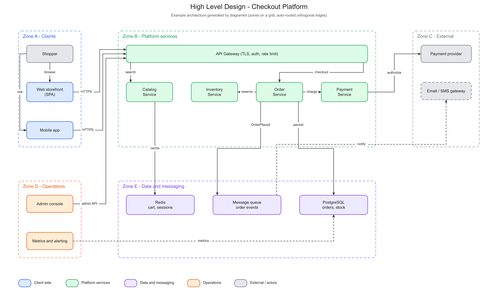

# diagramkit

Sequence diagrams and HLD (architecture) diagrams from a small JSON/YAML spec.
One spec in, four files out: **`.excalidraw`**, **`.svg`**, **`.png`**, **`.drawio`**.

- Pure Python. No internet, no Graphviz, no Node needed.
- Own layout engine: zones on a grid, nodes in a grid inside each zone, orthogonal arrows of at most 3 segments
  that go from box side to box side, labels on white boxes, collision check against boxes, manual waypoints (`via`).
- Palette: blue, green, orange, purple, gray (+ yellow, red). Themes: `default`, `mono` (print friendly), `dark`, or your own.
- Optional icons from a local path or URL. No third-party icons are bundled.
- Ships as a Claude Code Skill (`SKILL.md`).

## Install

```bash
pip install .            # from a clone; installs PyYAML + resvg-py (PNG renderer, prebuilt wheels)
pip install ".[cairo]"   # optional: cairosvg as alternative PNG backend (needs the Cairo library)
```

PNG backends are tried in this order: `resvg-py`, `cairosvg`, then (optional) Node + `sharp` when the env var
`DIAGRAMKIT_SHARP` points to the sharp module. If none works the other three formats are still written and a warning is printed.
The PNG renderer needs at least one system font (Arial, Helvetica, Liberation Sans or DejaVu Sans).

## CLI

```bash
diagramkit seq examples/login-sequence.yaml -o out/
diagramkit hld examples/checkout-hld.yaml   -o out/
diagramkit drawio some.excalidraw                  # convert any diagramkit .excalidraw to .drawio
```

Options for `seq` and `hld`: `-n NAME`, `-f excalidraw,svg,png,drawio`, `-t default|mono|dark`, `--scale 2`, `--strict`
(exit code 2 on warnings such as an edge crossing a box). `python -m diagramkit ...` works too.

## Sequence spec

```yaml
title: Login
subtitle: optional
theme: default            # default | mono | dark | {base: dark, colors: {blue: ["#fill", "#stroke"]}}
gap: 235                  # optional; auto-sized from labels when omitted
participants:
  - {id: usr, label: "User\n(Browser)", color: blue}     # or just a string id
  - {id: api, label: "API", color: green}
steps:
  - divider: "1. Sign in"
  - "usr->api: POST /login"            # solid arrow
  - "api-->usr: 200 + token"           # dashed arrow (reply)
  - {msg: {from: api, to: api, label: "audit"}}   # self message
  - note: "Rate limited"               # note over one or more participants
    over: [api]
    color: yellow                      # any palette color
  - frame: "alt  wrong password"       # frame (alt / loop / opt ...); nest freely
    over: [usr, api]                   # optional: derived from the steps inside
    steps:
      - "api-->usr: 401"
```

Step kinds: `divider`, `msg` (string, `{from,to,label,dashed}` or `[from,to,label]`), `note`, `frame`.

## HLD spec

```yaml
title: Checkout Platform
columns: 3                       # zone grid columns (default min(#zones, 3))
layout: {node_gap_x: 60, node_gap_y: 64, zone_gap_x: 120, zone_gap_y: 110}   # optional
zones:
  - {id: edge, label: "Zone A - Edge", color: blue, row: 0, col: 0, cols: 2}  # cols = node columns inside the zone
  - {id: ext, label: "External", color: gray, frame: false}                   # frame: false = invisible group
nodes:
  - {id: gw, zone: edge, label: "API Gateway", colspan: 2}
  - {id: db, zone: edge, label: "PostgreSQL", color: purple, icon: icons/pg.svg, dashed: false}
  - {id: x, zone: edge, label: "Spanning note", row: 1, col: 0, align: left, w: 300, h: 80}
edges:
  - "gw->db: persist"                   # a->b: label ; a-->b: label = dashed
  - {from: gw, to: db, label: "x", dashed: true, arrow: both,    # arrow: end | both | none
     from_side: bottom, to_side: top,                            # optional side override
     via: [[400, 300], [400, 500]]}                              # optional waypoints, absolute canvas coords
legend: {blue: "Existing", green: "New"}   # optional; or a list of {color, label, dashed}
```

- Zones without `row`/`col` flow left to right, top to bottom. Nodes without `row`/`col` flow inside their zone
  (`cols` columns). `colspan` makes a node span several columns.
- Colors: palette name, `"#rrggbb"` (fill is derived) or `[fill, stroke]`.
- Icons: `icon:` is a path (relative to the spec file) or an `http(s)` URL (svg, png, jpg). A failed icon is a warning, not an error.
- Routing: each edge picks the side pair with the cleanest route (straight, L, Z or U). Edges that share a box side
  get separate ports; parallel edges get separate lanes. Warnings are printed for any edge that still crosses a box or
  any label that overlaps a box; fix with `from_side`/`to_side` or `via`.

## Examples

`examples/` has two sequence specs (YAML and JSON) and one HLD spec. Rendered outputs are in `examples/out/`.



## Python API

```python
from diagramkit import seq, hld
from diagramkit.core import load_spec, write_outputs
d = hld.build(load_spec("spec.yaml"), "my-diagram")
write_outputs(d, "out/", formats=("svg", "png", "drawio"))
print(d.warnings)
```

## Development

```bash
pip install -e ".[dev]" && pytest
```

## License

MIT
